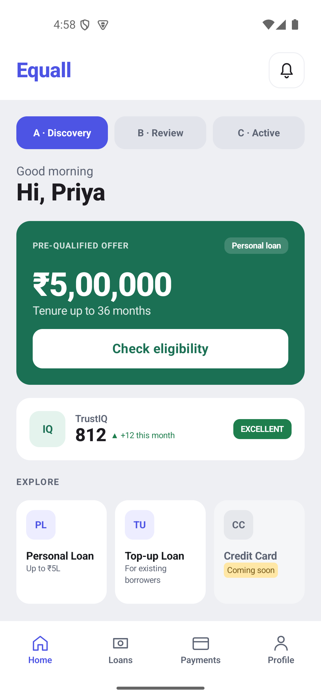
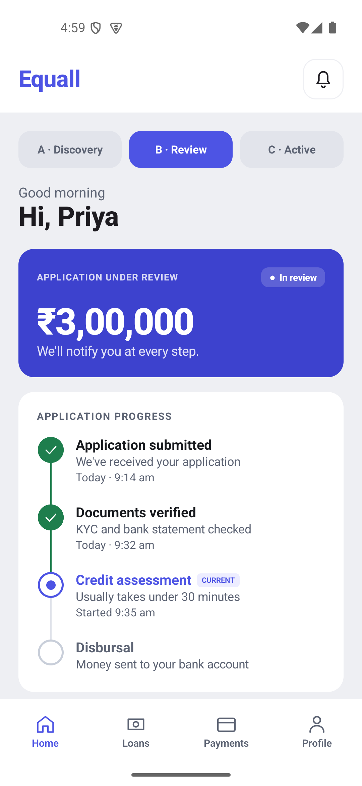
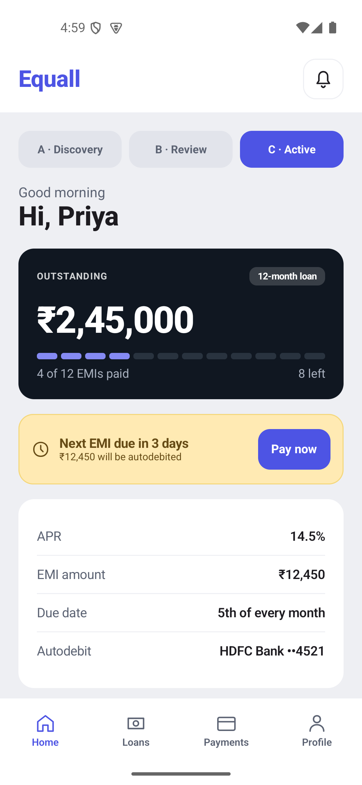

# Equall

A lending Home screen built with Kotlin Multiplatform and Compose Multiplatform for Android and iOS. The A / B / C tabs demonstrate discovery, application review, and an active loan using deterministic in-memory fixtures.

## Run Android

Requirements: Android Studio, JDK 17+, Android SDK 36, and an emulator/device running API 24+. Set `sdk.dir` in your untracked `local.properties`, or configure `ANDROID_HOME`.

Open the root folder in Android Studio, sync Gradle, and run **androidApp**. From a terminal:

``sh
./gradlew :androidApp:assembleDebug
./gradlew :androidApp:installDebug
```

The APK is at `androidApp/build/outputs/apk/debug/androidApp-debug.apk`.

## Run iOS

Requirements: macOS, full Xcode with an iOS SDK, JDK 17+, and network access on the first build. The Command Line Tools installation alone is insufficient.

1. Open `iosApp/iosApp.xcodeproj` in Xcode.
2. Select the `iosApp` scheme and an Apple Silicon iPhone simulator (iOS 15+).
3. Run. The build phase invokes `:shared:embedAndSignAppleFrameworkForXcode` automatically.
4. For a physical device, set your signing team and a unique bundle identifier in the target's Signing & Capabilities settings.

If Xcode cannot find Java, configure `JAVA_HOME` in its build environment. Targets include `iosArm64` (device) and `iosSimulatorArm64`; Intel Mac simulators are not configured.

## Architecture

All product UI, fixtures, formatting, and behavior live in `shared/src/commonMain/kotlin/com/example/equall`:

- **domain/**: sealed `LoanLifecycle`, typed models, `HomeRepository` interface, `GetHomeDataUseCase`, and `CheckEligibilityUseCase`. Pure Kotlin; no Compose or data imports.
- **data/**: in-memory DTO source, explicit DTO-to-domain mapping, and repository implementation. Depends on domain.
- **presentation/**: lifecycle ViewModel with read-only `StateFlow<HomeUiState>`, sealed `HomeEvent` actions, platform-independent currency formatting, and state-rendering composables. Depends on domain.
- **di/**: composition root using manual constructor injection to connect the layers. The app root obtains a lifecycle-owned ViewModel; leaf composables receive only state and callbacks.

`androidApp` contains the Android entry point and platform resources. `iosApp` contains the SwiftUI entry point. A small `shared/src/iosMain` UIKit bridge is necessary to host Compose on iOS; it contains no screen or business logic. Tests live in `shared/src/commonTest`.

## Behavior

- Discovery: ₹5,00,000 offer, up to 36 months, TrustIQ 812 / EXCELLENT / +12, and three product cards.
- Check eligibility transitions to review only for EXCELLENT, regardless of numeric score. Other tiers show a dismissible explanation and remain in discovery.
- Review: ₹3,00,000 and four steps, with green checks for completed, a purple ring/current label for current, and an empty gray ring for pending.
- Active: ₹2,45,000 outstanding, four of twelve segments paid, loan details, and an EMI banner. Due in three days or fewer uses amber warning styling; later dates use purple styling.
- Credit Card has disabled click semantics and is also rejected by the event handler. The other product cards and Pay now show demo messages. No payment is taken.
- Bottom navigation is visual only, with Home selected. The notification icon is decorative.

For manual edge-case checks, construct `FakeHomeDataSource(tier = "GOOD")` or `FakeHomeDataSource(daysUntilDue = 4)` in `HomeModule`. The defaults reproduce the supplied mockup. The due-day count and timestamps are fixed fixture values, not a live clock.

## Tests and limitations

Shared tests cover all fixture mappings, eligibility tiers, successful/rejected transitions, disabled Credit Card handling, warning boundaries, Indian currency grouping, and load retry.

```sh
./gradlew :shared:testAndroidHostTest
# Requires full Xcode:
./gradlew :shared:iosSimulatorArm64Test
```

The mockup's font asset was not supplied; the app uses platform sans-serif typography. Content scrolls on smaller screens while navigation stays fixed. This is a Home-screen assignment, with no backend, authentication, payment processing, or other navigation destinations.

Verified locally on 12 October 2026:

- `:androidApp:assembleDebug` succeeds.
- `:shared:testAndroidHostTest` passes all 7 tests (0 failures).
- Pixel 4a API 35 emulator: checked Discovery → Review via eligibility, Active toggle, payment demo dialog, and scrolling to TrustIQ.
- Xcode project and shared scheme pass structural validation. iOS compilation/simulator execution remain **unverified** because full Xcode is not installed on the development machine.
- Public GitHub publication is **pending** the destination repository/account and authentication.

## Android screenshots

| Discovery | Application under review | Active loan |
| --- | --- | --- |
|  |  |  |

The review/active content scrolls on this smaller emulator. [Active loan lower details](docs/screenshots/active-details.png).
